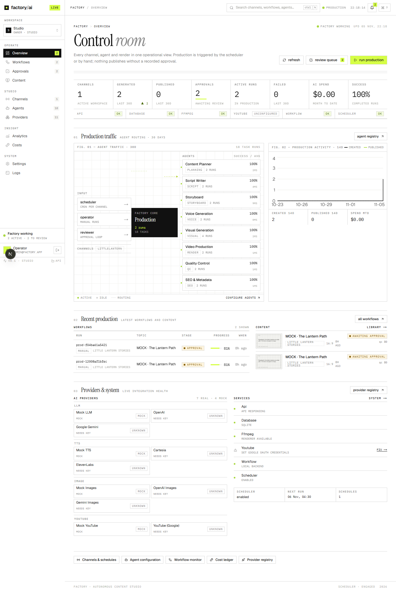
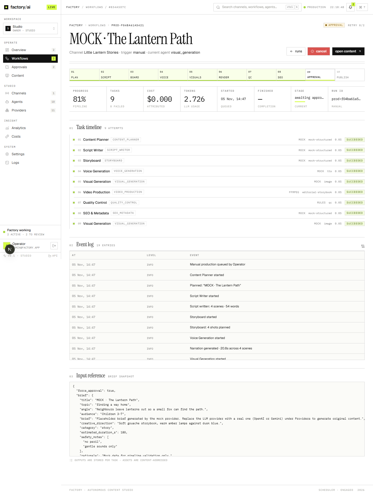
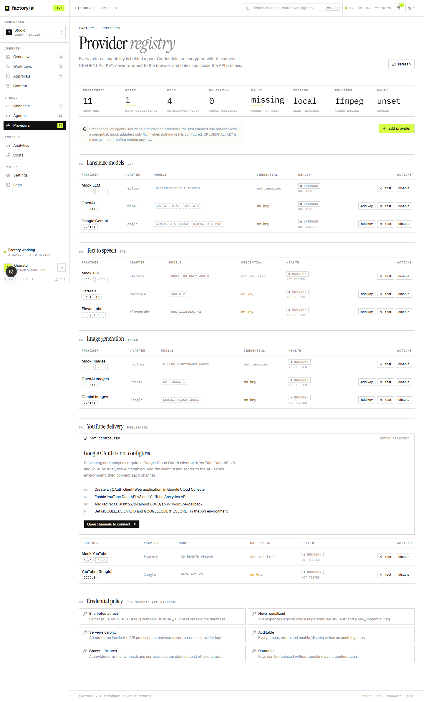
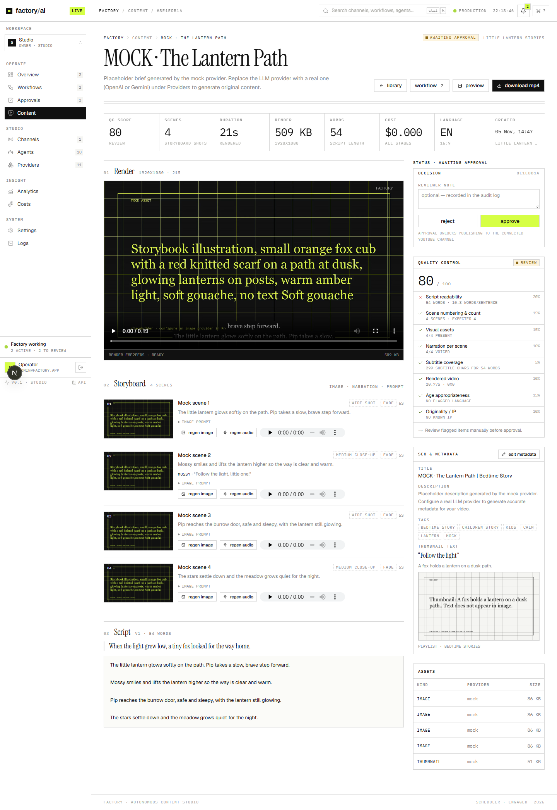
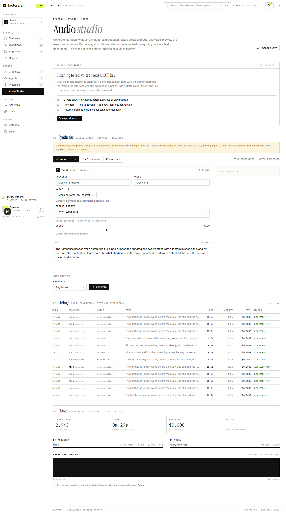
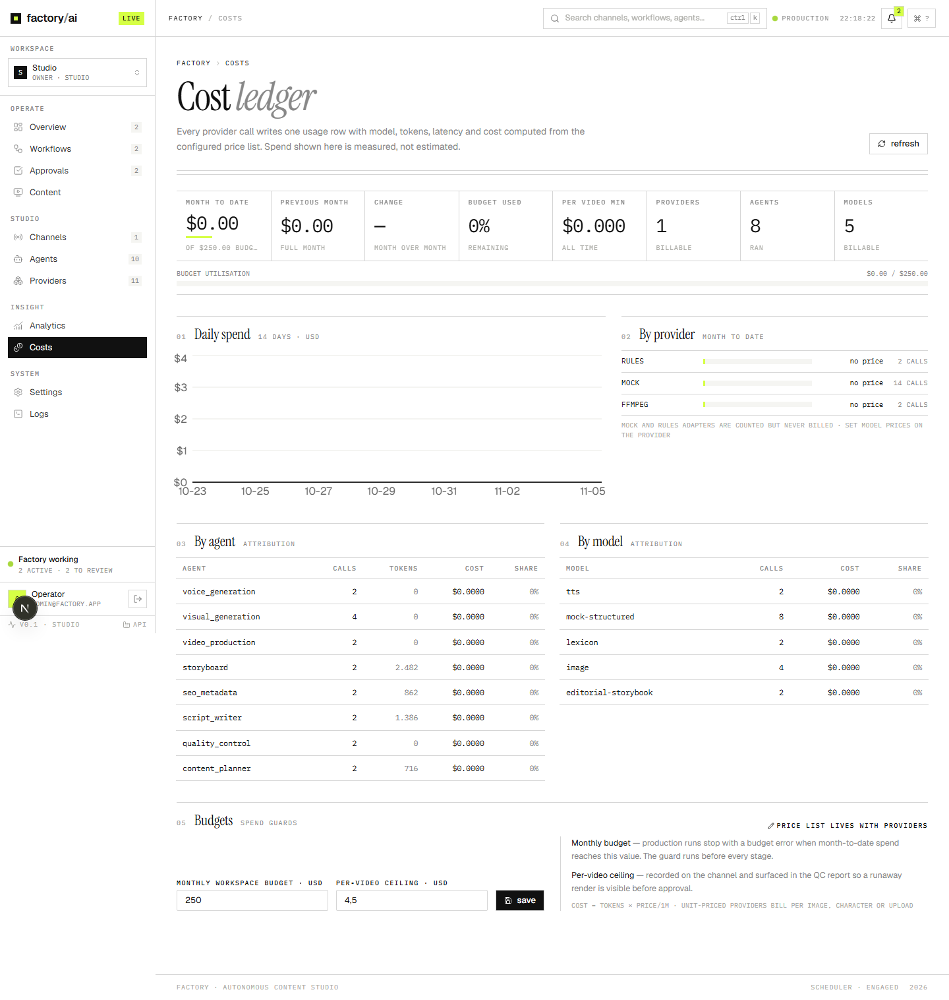

# FACTORY — Autonomous AI YouTube Content Factory

**From idea to published video, on autopilot — with you in control of the publish button.**

FACTORY is a production studio for YouTube channels. You give it a channel — who it's for, what it
sounds like, how often it publishes — and it plans, writes, narrates, illustrates, animates,
quality-checks and schedules complete videos. Every step is visible, editable and costed, and nothing
reaches YouTube until you approve it.

It is built for people who run one channel carefully and for teams that run many at once: children's
story channels, explainers, documentary-style storytelling, and vertical Shorts.



---

## Why it feels different

**It shows its work.** Each video is a chain of ten specialist agents — planner, writer,
storyboard, voice, visuals, video production, QC, SEO, publisher, analyst. Every agent has a typed
contract, every output is validated before the next step starts, and every run is written to the
database as it happens. You can watch a render progress, read the script, and see exactly which
provider produced which asset.

**Nothing is faked.** If an integration isn't configured, the interface says so and links to the
exact place to configure it. Mock providers are labelled as mocks. Empty states are empty. Every
number on screen comes from a stored row.

**It looks like a magazine, not a dashboard.** White paper, near-black ink, hairline rules,
Instrument Serif display type, IBM Plex Mono metadata and one functional lime accent. Dense where it
matters, calm everywhere else.

**Humans stay in the loop.** A budget guard, an approval gate for Made-for-Kids content, and a
one-click cancel that stops a render mid-encode.

---

## What you can do with it

### Plan a channel, not a video

Channels carry their own audience, tone, voice, publishing cadence and format (16:9 or 9:16).
Define them once; the factory keeps producing on schedule, deduplicating ideas it has already
covered and respecting each channel's timezone.

### Watch a story become a video

1. **Plan** — the planner proposes an angle for the channel and its recent history.
2. **Write** — a full script with hook, scenes and call to action.
3. **Storyboard** — scenes with narration, visual direction, transitions and duration.
4. **Voice** — Cartesia or ElevenLabs, scene by scene, with long narration split into
   sentence-aware chunks so nothing is clipped.
5. **Visuals** — one generated image (or video clip) per scene, stored content-addressed.
6. **Render** — a Remotion composition assembles images, narration, music, captions,
   transitions and title/outro cards into an MP4.
7. **Quality control** — the encoded file is inspected (resolution, frame rate, duration, audio,
   A/V sync, faststart) and the script is checked for age-safety, pacing and completion.
8. **SEO** — title, description, tags and chapters, ready for review.
9. **Approve** — you read, edit or reject.
10. **Publish & learn** — upload with the right audience settings, then pull analytics back in.



### Bring your own models

Use hosted leaders (OpenAI, Gemini, Cartesia, ElevenLabs) or point FACTORY at **any endpoint that
speaks the OpenAI or Anthropic API** — Groq, Together, OpenRouter, DeepSeek, Mistral, xAI, Ollama,
LM Studio, vLLM, LiteLLM, or your own gateway. Paste a base URL and a key, press **list models**, and
the factory reads the model list straight from your provider.

Keys are stored encrypted with AES-256-GCM, never returned by the API, and can be rotated or deleted
without restarting anything. Every change is audited.



### Build a visual identity per format

Six Remotion templates ship in the box, each with its own colours, typography, caption style and
scene framing:

| Template | Format | Look |
| --- | --- | --- |
| YouTube · Editorial | 16:9 | white paper, ink rules, serif lower thirds |
| Children's story | 16:9 | pastel ground, rounded vignette, sticker badges |
| Educational | 16:9 | dark split frame with a didactic side panel |
| Storytelling | 16:9 | cinematic letterbox, slow Ken Burns, serif overlays |
| Short-form | 9:16 | full-bleed art with chunky subtitles |
| YouTube Shorts | 9:16 | the editorial identity, vertical |

Templates are React components: adding a new one is a single file plus a registry entry, without
touching the renderer.

### Preview before you render

The dashboard embeds Remotion's Player running the **same composition code** the renderer uses, with
scene-by-scene navigation and a frame-accurate timeline. What you see is what gets encoded.



### Hear it before you ship it

The Audio Studio supports single-voice generation, A/B comparison of two configurations, and
multi-speaker dialogue — with usage and cost tracking per provider.



### Know what it costs

LLM tokens, image generations, speech characters and render compute are logged per run, per agent and
per provider, with separate list-price and configured-price estimates so you can see where the money
goes.



---

## Installation

### Requirements

| Tool | Version | Needed for |
| --- | --- | --- |
| Python | 3.12+ | API and worker |
| Node.js | 18+ (22 LTS recommended) | web app and Remotion renderer |
| FFmpeg | any recent build | `ffprobe` inspection; Remotion bundles its own encoder |
| PostgreSQL | 16 | production database (SQLite works for local development) |
| Redis | 7 | caching and rate limits |

### 1 · Get the code

```bash
git clone https://github.com/NadhifFauzilAdhim/content-agent.git
cd content-agent
```

### 2 · Remotion engine

The video engine is a small Node project. Install it once:

```bash
cd services/media-engine/remotion
npm install
npx remotion compositions src/index.tsx   # should list six compositions
```

Remotion downloads a headless Chromium the first time it renders.

### 3 · API

```bash
cd ../../../apps/api
python -m venv .venv
# Windows: .venv\Scripts\activate · macOS/Linux: source .venv/bin/activate
pip install -e ".[dev]"

cp ../../.env.example .env
python -m app.cli gen-key          # prints APP_ENCRYPTION_KEY — paste it into .env
alembic upgrade head                # create the schema (skip for SQLite, it self-creates)
uvicorn app.main:app --reload --port 8000
```

Interactive API reference: <http://127.0.0.1:8000/docs>

### 4 · Web

```bash
cd ../web
npm install
echo "API_INTERNAL_URL=http://127.0.0.1:8000" > .env.local
npm run dev
```

Open <http://localhost:3000> and sign in with the bootstrap account from your `.env`:

```
admin@factory.app / factory-admin-2026
```

Change that password in **Settings → Security** before anything else.

### 5 · First run

1. **Providers** — add at least one LLM. Mocks work for a test drive; add OpenAI, Gemini, or your own
   OpenAI-/Anthropic-compatible endpoint for real output.
2. **Providers → Text to speech** — add Cartesia or ElevenLabs, or keep the mock.
3. **Providers → Image** — add an image provider, or keep the mock.
4. **Channels** — create a channel: audience, tone, format, publishing schedule.
5. **Workflows → Run** — start a production and watch it move through the stages.

### Docker

The images are self-contained: Node, the Remotion packages, headless Chromium and its libraries are
all baked in, so the host only needs Docker.

```bash
cp .env.example .env                 # set JWT_SECRET and APP_ENCRYPTION_KEY at minimum
python -m app.cli gen-key            # from apps/api (or any shell with the API deps)
docker compose --profile full up -d --build
```

| Service | Port | Role |
| --- | --- | --- |
| `web` | 3000 | dashboard |
| `api` | 8000 | REST API, runs workflows and the render queue |
| `worker` | — | scheduler and durable workflow runner |
| `postgres` · `redis` | 5432 · 6379 | database and cache |
| `temporal` · `temporal-ui` | 7233 · 8088 | optional, only with `--profile temporal` |

The API applies migrations and seeds the workspace on start. Uploaded assets and rendered videos
live in the `factory-storage` volume. The first build takes a while (it downloads Chromium); later
builds only redo the layers that changed.

The docker-compose file enables only `postgres` and `redis` by default, so `--profile full` is
required for the application services.
### Dedicated render worker

Rendering is CPU-heavy. By default it runs inside the API so a single process is enough. To move it
off the request path:

```bash
# .env
RENDER_IN_API=false

python -m app.worker --render-only
```

Both processes share the same `render_jobs` table, and a job is only ever rendered once.

---

## Configuration

Everything in `.env` is optional except the secrets below. The essential ones:

| Variable | Purpose |
| --- | --- |
| `DATABASE_URL` | PostgreSQL or SQLite connection string |
| `JWT_SECRET` | session signing key (`python -c "import secrets;print(secrets.token_urlsafe(48))"`) |
| `APP_ENCRYPTION_KEY` | master key for the credential vault (`python -m app.cli gen-key`) |
| `WEB_ORIGIN` | origin of the web app, used for CORS and cookies |
| `STORAGE_BACKEND`, `STORAGE_ROOT` | `local` for development, `r2` for Cloudflare R2 |
| `RENDER_IN_API` | `true` renders in-process, `false` defers to the worker |

Provider keys are **not** required in `.env` — add them in the UI and they will be encrypted at
rest. `OPENAI_API_KEY`, `GEMINI_API_KEY`, `CARTESIA_API_KEY` and `ELEVENLABS_API_KEY` only exist to
seed defaults on first boot.

Full reference: [`.env.example`](.env.example) and [docs/06-deployment.md](docs/06-deployment.md).

---

## Architecture at a glance

```
apps/web                     Next.js 16 · TypeScript · Tailwind v4 · Remotion Player
apps/api                     FastAPI · SQLAlchemy 2 · Alembic · JWT · AES-256-GCM vault
  app/agents                 ten agents, typed contracts, schema-validated outputs
  app/adapters               OpenAI · Gemini · OpenAI/Anthropic-compatible · Cartesia · ElevenLabs · R2 · Remotion · YouTube
  app/services               render queue · storyboard spec · TTS · credentials · pricing
  app/workflow               pipeline · scheduler · local durable runner · Temporal adapter
services/media-engine/remotion   compositions, templates, render CLI
infrastructure/docker        API and web images, nginx
docs                         architecture, design system, schema, agents, API, deployment
```

Documentation index: [docs/README.md](docs/README.md) · video engine:
[docs/10-video-engine.md](docs/10-video-engine.md) · credentials and speech:
[docs/09-credentials-and-tts.md](docs/09-credentials-and-tts.md)

---

## Licence notes

This repository does not currently ship a `LICENSE` file — add one before distributing it.

**Remotion**, the video engine, has its own terms: free for individuals, teams of up to three,
non-profits and evaluation; larger companies need a Company Licence before production use
(https://www.remotion.dev/docs/license). Set `REMOTION_LICENSE_KEY` in `.env` once you have one.

YouTube API usage is subject to Google's quota and policy terms, and AI provider usage to each
provider's terms and pricing.
