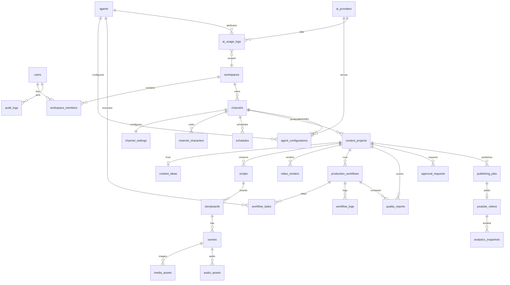

# 03 · Database design

PostgreSQL 16, UUID PKs (client-side `uuid4` default), `timestamptz` everywhere, `deleted_at` soft
delete on content-bearing tables, `CHECK` constraints on enums.

## Conventions

- `id uuid PK`, `created_at`, `updated_at` (server default now), `deleted_at nullable`.
- Tenant tables carry `workspace_id uuid FK → workspaces.id ON DELETE CASCADE` (indexed).
- Status columns are `varchar` + `CHECK` so Alembic stays simple while still constraining values.
- Money stored as `numeric(12,6)` USD; tokens as `bigint`; durations as `numeric seconds`.
- JSON blobs (`*_json`) are used only for agent I/O payloads that are contract-validated in Pydantic.

## Relationships (mermaid)

## Tables

### Identity & tenancy
- **users** — `email unique`, `password_hash`, `name`, `avatar_color`, `is_active`, `last_login_at`.
- **workspaces** — `name`, `slug unique`, `plan`, `monthly_budget_usd`, `settings_json`.
- **workspace_members** — `(workspace_id, user_id) unique`, `role in (owner, admin, editor, viewer)`.
- **api_keys** — workspace-scoped machine tokens (hashed), `last_used_at`.

### Channels
- **channels** — `workspace_id`, `name`, `handle`, `description`, `niche`, `audience`, `language`
  (BCP-47), `video_format in (16:9, 9:16, 1:1)`, `is_active`, `youtube_channel_id null`,
  `oauth_connection_id null`.
- **channel_settings** — 1:1 with channel: `visual_style`, `palette_json`, `content_guidelines`,
  `made_for_kids bool`, `target_duration_seconds`, `cost_ceiling_usd`, `approval_mode
  in (always, below_score, never)`, `min_quality_score`.
- **channel_characters** — reusable cast with locked appearance description (`visual_prompt`), voice.
- **schedules** — `channel_id`, `timezone`, `days_of_week int[]`, `production_count`, `start_time`,
  `publish_time`, `max_concurrent`, `require_approval`, `auto_publish`, `is_enabled`, `next_run_at`.
  Unique partial index prevents duplicate active schedules per channel slot.

### AI configuration
- **ai_providers** — `kind in (llm, tts, image, video, youtube, storage)`, `name`, `vendor`,
  `base_url`, `models_json`, `credential_ciphertext bytea` (Fernet), `credential_fingerprint`,
  `is_enabled`, `health in (unknown, ok, degraded, error)`, `health_checked_at`, `cooldown_until`.
- **agents** — registry: `key unique`, `name`, `role`, `description`, `category`, `stage`,
  `input_schema_json`, `output_schema_json`, `is_enabled`.
- **agent_configurations** — `(agent_id, channel_id nullable) unique`: `provider_id`, `model`,
  `temperature`, `max_tokens`, `prompt_system`, `params_json`, `retry_policy_json`, `fallback_provider_id`.

### Content production
- **content_ideas** — `channel_id`, `title`, `topic`, `angle`, `audience`, `brief`, `rationale`,
  `score`, `source in (agent, manual)`, `selected bool`.
- **content_projects** — `channel_id`, `idea_id null`, `title`, `slug`, `status`, `language`,
  `format`, `estimated_duration_s`, `thumbnail_asset_id`, `metadata_json`, `published_at`.
- **scripts** — `project_id`, `version`, `title`, `description`, `narration`, `sections_json`,
  `word_count`, `estimated_duration_s`, `is_current`.
- **storyboards** — `script_id`, `version`, `style_guide`, `is_current`.
- **scenes** — `storyboard_id`, `index`, `title`, `narration`, `dialogue_json`, `camera`,
  `composition`, `characters_json`, `background`, `action`, `image_prompt`, `negative_prompt`,
  `sfx_json`, `duration_s`, `transition`. `(storyboard_id, index) unique`.
- **media_assets** — `project_id`, `scene_id null`, `kind in (image, thumbnail, music, sfx, subtitle,
  other)`, `storage_key`, `mime_type`, `width`, `height`, `bytes`, `checksum_sha256`,
  `provider`, `license`, `prompt`, `cost_usd`, `status`.
- **audio_assets** — `scene_id null`, `project_id`, `kind in (narration, dialogue, music)`,
  `voice_id`, `provider`, `storage_key`, `duration_s`, `sample_rate`, `bytes`, `cost_usd`.
- **video_renders** — `project_id`, `template`, `resolution`, `fps`, `storage_key`, `duration_s`,
  `bytes`, `status in (queued, rendering, ready, failed)`, `progress`, `error`, `started_at`,
  `completed_at`, `cost_usd`.

### Orchestration
- **production_workflows** — `channel_id`, `project_id`, `workflow_key` (Temporal id, unique),
  `status` (PART 5 enum), `stage`, `current_agent_key`, `progress`, `retry_count`, `max_retries`,
  `cost_usd`, `input_json`, `output_json`, `error_message`, `started_at`, `completed_at`,
  `next_retry_at`.
- **workflow_tasks** — `workflow_id`, `step_index`, `agent_key`, `name`, `status
  (pending, running, succeeded, failed, skipped, retrying)`, `attempts`, `duration_ms`,
  `input_json`, `output_json`, `cost_usd`, `error`, `started_at`, `completed_at`.
- **workflow_logs** — `workflow_id`, `task_id null`, `level`, `message`, `context_json`, `at`.
- **quality_reports** — `workflow_id null`, `project_id`, `render_id null`, `score numeric(5,2)`,
  `approval_status in (pass, review, fail)`, `issues_json`, `warnings_json`,
  `recommendations_json`, `checks_json`, `regenerate_json` (targets to regenerate).
- **approval_requests** — `project_id`, `workflow_id`, `requested_by_agent`, `status
  (pending, approved, rejected, expired)`, `reviewer_id null`, `decision_note`, `expires_at`,
  `decided_at`.

### Publishing & analytics
- **publishing_jobs** — `project_id`, `render_id`, `status (queued, uploading, scheduled,
  published, failed, cancelled)`, `privacy in (public, unlisted, private)`, `made_for_kids`,
  `scheduled_for`, `attempts`, `error`, `youtube_video_id null`.
- **youtube_videos** — `project_id unique`, `youtube_video_id unique`, `title`, `published_at`,
  `url`, `privacy`, `made_for_kids`, `thumbnail_set`.
- **analytics_snapshots** — `youtube_video_id`, `captured_at`, `views`, `impressions`, `ctr`,
  `watch_time_minutes`, `avg_view_duration_s`, `subscribers_gained`, `likes`, `comments`.
  Index `(youtube_video_id, captured_at desc)`.
- **ai_usage_logs** — `workspace_id`, `provider_id`, `agent_key null`, `model`, `operation
  (llm_chat, tts, image, video, whisper)`, `input_tokens`, `output_tokens`, `units`,
  `unit_label`, `cost_usd`, `latency_ms`, `status`, `error`, `request_key`, `workflow_id null`,
  `created_at`. Indexed by `(workspace_id, created_at)` and `(provider_id, created_at)`.
- **audit_logs** — `workspace_id`, `actor_id`, `action`, `target_type`, `target_id`, `ip`,
  `metadata_json`, `created_at`.

## Indexing strategy

- FK columns are indexed (`ix_<table>_<fk>`); tenant queries always hit `workspace_id` first.
- Status columns used by dashboards are indexed with `created_at` for recent-first scans.
- `partial unique index` on `schedules (channel_id) where is_enabled` prevents duplicated cron jobs.
- `unique` on `ai_usage_logs.request_key` guarantees idempotent billing for retried activities.

## Soft deletion

`content_projects`, `scripts`, `storyboards`, `media_assets`, `channels` use `deleted_at`; list
queries filter `deleted_at IS NULL` by default.
